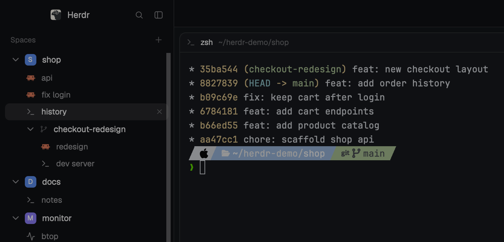

# Nested Tabs

Herdr's default window with the tabs moved out of the top bar and into the
Spaces sidebar. Each space lists its own tabs right under it, so you can see
what every space is running, and which agent needs you, without switching
spaces. New tabs come from a `+` on each space's row. The top bar keeps
Files and Changes and loses its tab chips and its `+`.

## What you see

Everything outside the sidebar list and the top bar is the same as Herdr's
`main` layout (0.1.13), with the theme's own colors. There's no title bar.

**Left: the sidebar**, 268px wide, `chrome` background, from top to bottom:

1. **Brand strip**, 46px (shipped `workspace-chrome`). You can drag the
   window by it.
2. **Spaces list** (this layout's `nested-tabs` mod) and **Agents list**
   (shipped `agents`). The two split the height equally, each at least 90px.
   - Header, 31px: "Spaces" in 11.5px `dim`, and a 26px `+` button on the
     right that makes a new space.
   - **Space row**, 30px (28px for a worktree), 8px radius. On the left: an
     18px fold arrow (a Lucide chevron drawn at 16px, `muted`; `dim` when the
     space has one tab or none), then an 18px
     rounded-square avatar with the space's first letter in bold white
     10.5px. The avatar colors come from a fixed six-color palette (`#22a99a`,
     `#e3814f`, `#5b8def`, `#8b7cf6`, `#3fae6a`, `#d9649a`) and are stored in
     the shared `space.colors`. Next comes the name (13px `foreground`, at
     most 150px wide, truncated), then on the right only what is unusual about
     its git state, in 11.5px `dim`: the repo name when it differs from the
     space name, and the branch unless it is `main`/`master` or matches the
     name. After that, `↑n` in `ansi2` and `↓n` in `ansi1`, the status mark
     when folded, and last an 18px `+` (12px plus icon, `dim`, `foreground`
     on a `hover` background when hovered) that adds a tab to this space.
   - **Worktree rows** sit under their repo's space, indented by 23px, with
     a branch icon in place of the avatar.
   - **Tab rows**, 26px each, 7px radius, 12.5px text, sit under their space
     and above its worktrees. The icon column lines up under the space's
     avatar (23px indent, plus 23px more under a worktree). Each row shows the
     program icon (14px; tinted icons in `muted`), the tab name, and the
     status mark at the right end. A tab nobody named (`tb<n>`) shows its
     program's name instead, or "Terminal", and a zoomed tab gets " Z" after
     its name. The selected tab in the active space is drawn in
     `foreground` on `selected` with a 12px × close. Other tabs are `muted`.
   - With more than one machine connected, the rows are grouped under a 26px
     header per machine ("This computer", then each remote one), each with a
     `+`, a green or dim connection dot and its own fold arrow.
3. **Footer**, 69px (shipped `workspace-chrome` with `footer: true`).

**Right: the work area**:

1. **Top bar**, 42px, `chrome` with a 1px `border` line underneath (this
   layout's `tabs-bar` mod). It has no tab chips: just empty space you can drag
   the window by, then on the right a **Files** and a **Changes** button (26px tall, a 14px icon and a 12px
   label, `selected` while their panel is open), and on Windows/Linux, the
   minimize, maximize and close buttons.
2. **Terminals** of the active tab, 8px padding and gap. Panes have a 10px
   radius, a 1px `border` (`accent` when focused) and a 30px header
   (shipped `pane`).
3. **Side panel**, 368px (280–900), hidden until Files or Changes opens it.
4. **Status bar**, 28px (shipped `workspace-status`).

## How it behaves

Agent status on a tab row, and on a folded space's row:

| Status  | Mark                                                   |
| ------- | ------------------------------------------------------ |
| working | 12px spinner in `working`, one turn every 900ms        |
| blocked | 6px dot in `blocked`                                   |
| done    | 6px dot in `done`                                      |
| idle    | nothing                                                |

- **Folding:** the arrow folds or unfolds a space's tabs, and so does a
  double-click anywhere else on the space's row. Folds survive restarts (they
  are kept in the mod's `localStorage` as `tabs.folded`). A folded space shows
  the status mark of the tabs it hides on its own row. An open space shows
  none, since its tabs show their own.
- **New tab:** the `+` on a space row selects that space if it isn't the
  active one, then opens Herdr's new-tab menu (terminal, agents, new space,
  worktrees), which adds the tab to the active space. The row underneath
  doesn't react to the click.
- **Highlight:** when a space is open and has tabs, its selected tab gets the
  highlight and the space row doesn't. A folded or tab-less active space
  highlights its own row.
- **Tab rows:** a click selects the tab, and switches to its space first if
  needed. A double-click renames it, a right-click opens Herdr's tab menu, and
  × closes it. Dragging moves the tab within its space only: the dragged row
  fades to 50% and a 2px `accent` line marks where it will land (above it
  when moving up, below it when moving down).
- **Space rows:** a click selects the space, a right-click opens the space
  menu, and dragging reorders spaces, but only among spaces on the same
  machine, with the same fade and line.
- **Top bar:** scrolling the wheel over it moves to the previous or next tab.
  The side panel is remembered per space, so switching spaces brings back
  that space's Files, Changes or closed state.
- **Git labels** update when a command or an agent turn ends in the space,
  when its terminal changes folder, when a local repo's `.git` changes, and
  every 60s while the window is in front.
- **Narrow sidebar** (under 160px): each space becomes a compact row with its
  number and `·`, or a `●` when it is blocked or done, and the tab rows are hidden.

## Built from

- **Layout** `layouts/nested-tabs.json`: a copy of Herdr's `main` 0.1.13
  (`cloned_from` says so) with two blocks swapped. `sidebar-lists` →
  `spaces` shows the `nested-tabs` mod instead of `spaces`, and `work` → `tabs`
  shows `tabs-bar` instead of `tabs`. Node tree: `root` row → `sidebar`
  column (`brand`, `sidebar-lists` column of `spaces` + `agents`,
  `sidebar-footer`) and `work` column (`tabs`, `work-body` row of `main`
  + `panel` stack of `files`/`changes`, `status`). Neither mod takes `props`.
- **`mods/nested-tabs/`**: a clone of the shipped `spaces` mod (0.1.13) with
  `tabRows()`, `chevron()`, `status()` and the folding added. It reads
  `spaces()` (each space's `tabs`, with `id`, `name`, `index`, `active`,
  `status`, `zoomed`), `panes()` (program icon and name per tab, git
  folder), `machines()`, `layout()` (sidebar width), `theme()`,
  `shared("space.colors")`. Commands: `space.select`, `space.move`,
  `space.new`, `tab.select`, `tab.move`, `tab.rename`, `tab.close`. Overlays:
  the shipped `menu` mod with `tab: "space"` or `tab: "tab"`, and the
  shipped `new-menu` (popup, 250 × 512) from each space's `+`.
- **`mods/tabs-bar/`**: a clone of the shipped `tabs` mod (0.1.13) with
  the chips and the `+` removed, keeping the panel buttons, the per-space panel
  memory (`localStorage` `panels`) and the window buttons. Commands:
  `layout.show`/`layout.hide`/`layout.select` for the panel, `tab.prev`/`tab.next`,
  `window.minimize`/`maximize`/`close`. Art:
  `win-min.svg`, `win-max.svg`, `win-restore.svg`, `win-close.svg`.
- **Shipped art it borrows:** `mods/workspace-chrome/` `chevron-down`,
  `chevron-right`, `spinner`, `branch`, `plus`, `server`, `monitor`;
  `mods/pane/close.svg`; `mods/files/file.svg`; `mods/changes/changes.svg`.
- **Programs:** `git status --porcelain=v2 --branch` and `git rev-parse` in
  each space's folder, through `exec` (on the space's machine), plus
  `hc machine ls/rm/add` to list and reconnect machines. Both come from the
  shipped `spaces` mod. Nothing reaches the network beyond Herdr's own
  machine connections.

## Watch out

- **Clones, not patches.** The mods are copies of the 0.1.13 `spaces` and
  `tabs` mods. Newer Herdr releases don't reach them. If the shipped ones
  changed, rebuild from the new versions and add the tab rows again, rather
  than copying these files.
- **Avatar colors are shared.** `space.colors` is the same shared key the
  shipped `spaces` mod writes, so switching layouts keeps the colors.
- **Tab drags must stay inside a space.** `tab.move` takes an index within
  the tab's own space. A drop on another space's tab is ignored, and so is
  the hover line over it.
- **`new-menu` only knows the active space.** It takes no space argument, so
  the row's `+` runs `space.select` before opening it.
- **Stop propagation** on the fold arrow, the `+`, the tab rows and ×: otherwise the
  press reaches the space row underneath and starts a space drag or a
  double-click fold.
- **Reset the drag on the list too.** The list's own mouse-up clears both
  the space and the tab drag, otherwise releasing between rows leaves a row
  stuck at 50%.
- **Watches files outside its folder:** `watchFolder` on each local repo's
  git directory, and `git` runs in every space's folder.
- **Narrow rail hides tabs.** Under 160px only the compact space rows show.

## Done when

- `herdr-app check` passes for `mods/nested-tabs` and `mods/tabs-bar`, and
  `layout.switch {"name":"nested-tabs"}` shows the window above.
- Every space lists its tabs under it, and closing a tab removes its row.
- The `+` on another space's row switches to that space and opens the
  new-tab menu; the new tab appears under that space. The top bar has no `+`.
- A space with one tab shows a dimmer arrow than one with several.
- Clicking a tab in another space switches to that space and tab.
- The arrow and a double-click on the space row both fold and unfold, and the
  fold is still there after restarting Herdr.
- An agent working in a tab shows a spinner on that row. When it finishes or
  asks for input, a dot appears. Folding the space moves that mark onto the
  space row.
- Dragging a tab onto another tab in the same space reorders them, and the
  top bar shows no tab chips.
- A worktree space appears under its repo's space, with its own tabs under it.
- Opening Files in one space and switching to another that had it closed
  closes the panel, and switching back opens Files again.
